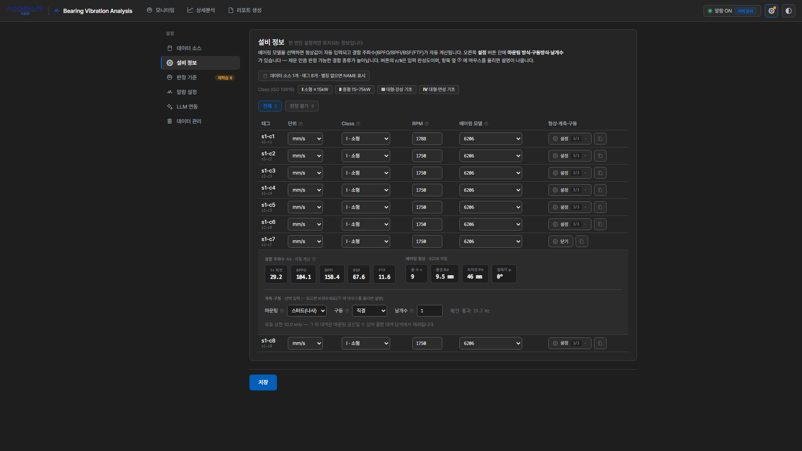

#

> The app's screens are in Korean. This guide gives each screen label in English with the Korean label in parentheses where it helps you find it.

## Entering the API token

Apart from the Neo console login, the app connects to the server with **an API token issued for each account**. The tables you see, the settings you save and the server-monitoring timers all run with that token account's permissions.

### Issuing a token

1. Sign in to the Neo web console as the account that will use the app.
2. Click the shield icon **①**, then the **+** button next to **TOKENS** **②**.
3. Enter a name for the token **③** (e.g. `bearing-analytics`) and click **Issue token** **④**. You can set the expiry date in **NotAfter** (10 years by default).

   

4. Copy the issued token (it starts with `nt_`) with the copy button **⑤**.

   

> The token string is shown only once, when it is issued. If you lose it, issue a new token.

### Entering it in the app

1. When you open the app, the settings screen shows only the **User info** (유저 정보) card. Until the token is verified, the other settings such as Data Source and the Monitoring, Detail Analysis and Report screens are not shown. Paste the copied token into the field **⑥** and press **Verify & save** (확인·저장) **⑦**.

   

2. Once verified, the card shows the **signed-in account** (접속 계정) and the masked token, and the app runs as that account.

   

- Only **a token of the account signed in to the console** is accepted. A token of another account is refused with "this is a token of account ○○" (○○ 계정의 토큰입니다) and not saved.
- The token is stored **in this browser only**, per account. Enter it again in another browser or on another PC.
- If the token is revoked or expires, the app returns to the token field. Entering a new token carries on. Server-monitoring timers belong to the account, not the token, so revoking a token does not stop them; a new token for the same account keeps managing them.
- To replace or remove it, use **Change token** (토큰 변경) or **Remove token** (토큰 지우기) on the same card. Removing it stops queries, evaluation and alert records in that browser (the server-monitoring timer keeps running).
- Nothing is queried until the token is verified.

## Before you start — storage and grants

The app runs **as the account of the API token you entered**. Which tables you see and where your settings
are stored both follow that account, so an administrator (SYS) has to prepare things once.

| Who | What |
| :--- | :--- |
| SYS | Settings → **User info** card → `Create` (만들기) — creates the dedicated database `NEO_BEARING_STORE` |
| SYS | Same card, **Package account permissions** (패키지 사용 계정 권한) list — press **Grant** (권한 주기) on that account's row (once per account) |
| SYS | Grant the data tables to analyze: `GRANT SELECT ON MACHBASEDB.SYS.<table> TO <account>;` |

An account without grants sees only a notice ("cannot reach the database") and a `Check status` (상태 확인) button.
Once the grants are in place, that button resumes the app without a reload.

The list shows each account's permission status (**granted** 권한 있음 · **partial** 일부만 있음 · **none** 권한 없음) and how many of this package's timers that account has registered. Use **Revoke** (권한 회수) for an account that no longer uses the package. Settings, events and learned baselines are not deleted, so granting again picks up where it left off. Before revoking, sign in as that account and turn off its alarms and band extraction — SYS cannot stop another account's timers, so any timers left behind fail on every cycle after the revoke.

When you delete the account itself (for example when someone leaves), **before deleting it** sign in as that account, turn off its alarms and band extraction, and revoke all of its tokens under **TOKENS** in the shield icon (Security) panel. Neo does not remove an account's API tokens or timers when the account is deleted — a leftover token can still read and write workspace files, and recreating an account with the same name hands the old tokens and timers to the new account. Also, an account that has used the app owns a settings table in the dedicated database (`NEO_BEARING_STORE.<account>.CONFIG`), so SYS has to drop that table first — Neo refuses to delete an account that still owns tables.

If an account cannot even sign in to the Neo console, it lacks access to the default database (`ERR-2835`).
That is a Neo prerequisite rather than a package one: `GRANT CONNECT ON DATABASE MACHBASEDB TO <account>;`

## The settings screen

When you first open the app, the monitoring screen shows a "no saved settings" (저장된 설정이 없습니다) notice and a **Start setup** (설정 시작) button. Press it to go to the **Settings** screen, where you define what to analyze. Settings is split into six sections down the left side.

| Section | Contents | Required |
| :--- | :--- | :---: |
| Data Source | User info, display time zone, TAG table selection, aliases | Yes |
| Equipment | **RPM · bearing model** (required for grading) · unit · class · measurement & drive | **Yes** |
| Criteria | Zone boundaries (thresholds), baseline learning, band & fault-pattern extraction | Optional |
| Alarms | Monitoring mode, evaluation interval & RMS window, notifications | Optional |
| LLM | Provider for detail-analysis and report opinions | Optional |
| Data management | Storage usage, ranged & per-tag data deletion | Optional |

Badges next to the section names count what still needs attention — under Equipment, **Cannot judge N** (판정 불가: tags with no RPM or bearing, so no grade) and **Unset N** (미설정); under Criteria, **Untrained N** (미학습) and **Retrain N** (재학습). Each section shows only one badge, with the more urgent one taking precedence (Cannot judge over Unset, Untrained over Retrain). While anything is left, the ⚙ button in the header also shows an amber dot.

Changing a setting shows an "unsaved changes" bar at the bottom of the screen; pressing **Save** reloads live data. **Changes take effect only once saved** — until then the monitoring screen, in-app judgment, and server monitoring all keep running on the previous settings. Navigating away with unsaved changes prompts for confirmation (**Cancel** · **Discard and leave** · **Save and leave**). **Discard and leave** throws the edits away and restores the saved settings.

A few buttons save their one value immediately:

- the alarm on/off indicator in the header
- **Apply** in the extraction-interval dialog
- the LLM provider picker in reports and detail analysis
- **Save measured N rpm** in the detail-analysis speed warning

Other unsaved edits on the Settings tab are not saved along with them.

## Display time zone

In **Settings → Data Source**, **Display time zone** sets which clock the screen shows. The default is the browser's time.

- Cards, charts, the event list, date pickers, the start of "today", reports, and notification text all follow this zone.
- Data queries do not depend on any time zone — they always look at the same instant, even when the server and browser are in different zones.
- To read times in the plant's local time, pick that region and save. Reports record the zone they were made in, and their charts use it too.

## Data Source

First choose which data to analyze.

1. Tables detected in Neo are listed with a kind badge.
2. Select the tables to analyze. **Multiple tables** can be selected at once.
3. Tags from the selected tables appear in the alias table below.

Nothing is selected initially. Select only the tables you actually want to analyze.

### Column layout

Queries use the Machbase TAG table standard column names (`NAME` · `TIME` · `VALUE`). TAG tables with different column names are not supported yet; they appear greyed out in the list and cannot be selected (the reason is shown).

### ROLLUP

Trend charts and server monitoring read the TAG table's **ROLLUP** (a pre-aggregated summary) for speed. You can select a table without a rollup, but the app then aggregates raw data directly, with these limits:

- Trend charts in Detail Analysis and reports show only the **last 2 hours** of the chosen period. The rollup unit field gets a `원본 집계` (raw aggregation) suffix and a notice appears below it.
- The trend the monitoring screen loads first is also shortened to roughly the last 5 million rows.
- **Server monitoring skips the table.** App monitoring still evaluates it.

Tables without a rollup carry a **ROLLUP 없음** (no ROLLUP) badge in the list, and selecting one shows what is limited on the right. To view long periods, create a rollup on the table.

### Aliases

Tags are shown as `alias (tag name)`. If the original tag name is long or code-like, set an alias to make it readable. Aliases are used on monitoring cards, in detail analysis, in reports, and in notification messages. Leave it blank and the original tag name (`NAME`) is shown as-is. Use the search box when you have many tags.

### Load limits

To avoid query storms, the app loads at most **60 tags per table** and **100 pieces of equipment overall**. Tags left out by the limit carry an **Excluded from monitoring** (감시 제외) badge in the alias table, and a notice appears above the Monitoring screen. Narrow the scope by selecting only the tables you need.

### Data source change detection

If a selected table or tag is removed from the DB or becomes empty, a change banner appears at the top of the Monitoring screen. Use **Reload** to refresh or **Dismiss** to close it.

## Equipment

The app needs to know what each tag actually is before it can produce a grade. Tags with nothing set yet are marked with an amber dot.

> **RPM and bearing model are required.** The fault pattern that switches the grade on is computed on a fault-frequency grid, and without shaft speed and bearing geometry that grid cannot be built. If either is missing, that tag's **grade never rises** — which is "cannot judge", not "normal". On screen:
>
> - Monitoring card: an **On hold** (판정 보류) badge instead of a grade (hover shows "cannot judge")
> - Equipment list: the **Cannot judge** (판정 불가) filter and the **Cannot judge N** badge on the left
> - Detail analysis: "criteria n/N (… not applied)"
>
> The remaining fields (unit, class, measurement, drive) can stay empty and judgment still runs. An empty unit is treated as **mm/s (velocity)** and an empty class as **Class II**.

| Field | Description |
| :--- | :--- |
| **RPM** | The actual running speed of the shaft carrying the bearing — the basis of the fault-frequency grid. **Leave it empty and no judgment is produced** (it is never guessed) |
| **Bearing model** | Pick from the catalog and geometry plus fault frequencies are computed automatically. **Leave it empty and no judgment is produced** |
| Unit | `mm/s` (velocity) · `g` (acceleration) · `μm` (displacement) — the quantity the sensor stores. Empty means mm/s, so **always set the right unit for acceleration and displacement sensors** — a wrong unit converts the values wrongly and the grade height goes off |
| Class | Equipment class (I–IV). Sets the ISO 10816 zone boundaries that decide the grade height. Empty means Class II |

Hovering the <kbd>?</kbd> next to each field name shows what the value is, where to find it, and what happens if you leave it empty. The **All · Cannot judge** filter above the list narrows it to the tags that need work.

**Leave fields you don't know empty.** Only the faults judged from that field are reported as "not observable with this measurement"; the rest of the diagnosis proceeds normally. Filling a field by guessing is worse — the guess becomes evidence. (The unit was fixed when the data was loaded, so ask whoever set up the measurement.)

### RPM — entering it exactly

RPM is never guessed. A wrong speed throws the whole fault-frequency grid off while the screen goes on producing grades as usual. **Read it off the nameplate and enter it exactly, or leave it empty and let it read "cannot judge".**

"Exactly" means **the actual running speed of the shaft carrying the bearing**.

- Enter the nameplate **rated speed** (e.g. 1750 for a 4-pole 60 Hz motor), not the synchronous speed (1800). The fault pattern computes fault frequencies from this value and matches them with a **1% tolerance**, so a 2–3% error like the synchronous speed misses the fault.
- When detail analysis measures the speed from the spectrum and it differs from the entry by **more than 2%**, it shows a warning with a **Save measured N rpm** button. The button saves immediately. The measured value reflects the load at that moment; for machines whose load swings widely, re-check at the usual operating point.
- Why the measured value is not used for matching directly — in verification on public data, matching with the measured speed did not raise detections and only added false alarms. On machines with a weak running-speed peak (acceleration sensors, for example) the measurement often fails anyway.
- On a **belt drive**, enter the motor's rated speed. If the sensor sits on a bearing across the belt (fan, pump, …), press the **Settings** button → belt specification and set **sensor position to driven side** — the app converts the speed by the pulley ratio, or uses a measured driven-shaft speed if you enter one (see measurement and drive below).
- If the sensor is on a **gearbox (gear) output shaft**, enter that shaft's speed (motor speed ÷ gear ratio).

### ISO class reference

| Class | Applies to |
| :---: | :--- |
| I | Small machines (≤ 15 kW) |
| II | Medium machines (15–75 kW) |
| III | Large machines · rigid foundation |
| IV | Large machines · flexible foundation |

### Bearings and fault frequencies

Selecting a bearing model from the catalog fills in geometry (ball count, ball diameter, pitch diameter, contact angle) and computes BPFO / BPFI / BSF / FTF together with RPM. Press the **Settings** button on the right of the table to inspect the computed values.

- **Bearing not in the catalog** — choose **Custom** (직접 입력) in the bearing column. That row's settings panel opens automatically with the **cursor in the designation field**. Enter the designation and ball count `n`, ball diameter `Bd`, pitch diameter `Pd`, and contact angle `φ`. If a catalog model was selected just before, its designation and geometry are pre-filled and **saved as they are**, so you can start from a similar model and change only what differs.
- **Designation field** — note the actual designation (e.g. `SKF 22218 E`, up to 40 characters). The bearing column in the table shows it as `SKF 22218 E (직접)`, and detail analysis and reports as `SKF 22218 E (직접 입력)`; judgment does not use it.
- **Roller bearings (22218, 23124, NU312, …)** — not in the list. The same designation has a different roller count per maker and design suffix (E, CC, CA), so a single value shifts the fault frequencies enough to miss the fault. Enter the maker's catalog values directly. Equipment that picked one of them from the old list is switched to Custom automatically, with the old designation in the designation field and the old values in the geometry fields (judgment results are unchanged). If an amber note appears in the panel, check the values against the catalog.
- **Sleeve (journal) bearings** — with no rolling elements, BPFO/BPFI/BSF/FTF are undefined. The fault pattern therefore cannot be built: **the grade never rises, the card always reads On hold** (cannot judge), and the tag counts under **Cannot judge** in Equipment. The rule-based diagnosis in detail analysis still works from 1× and 2× rotational frequency.

Once a bearing is registered, fault-frequency markers appear on the detail-analysis FFT so you can match peaks to specific faults.

### Applying to several tags at once

The copy button on the right of the table opens a dialog that copies that row's values to other tags — handy when the X/Y/Z channels of one machine share RPM, bearing, and mounting.

- **Fields to copy** — only filled values appear as chips; click to toggle. Unit · class · RPM · bearing · designation and the four geometry fields (with Custom) · measurement (mounting) · drive · sensor position · pulley diameters · belt length · driven-shaft speed · vane/tooth count.
- **Target** — the same machine (tags sharing the name prefix) · the same table · the current list.

### Measurement and drive

The **Settings** button on the right of the table opens the fault frequencies and geometry along with fields for measurement and drive details. The `n/N` on the button is an input-completeness count.

| Field | What it does for diagnosis |
| :--- | :--- |
| Mounting | The trustworthy upper frequency for each attachment method — stud 10 · adhesive 5 · magnet 2 · handheld probe 1 kHz |
| Drive type | Direct · belt · gear. For belt, the belt specification row appears |
| Vane / tooth count | Vane count × rotational frequency = vane pass frequency (for gears, tooth count × rotational frequency = mesh frequency) |
| Belt specification | Pulley **pitch diameters** D1 (drive/motor side) · D2 (driven side) and belt length. The pitch diameter is where the belt rides — the value stamped on the pulley or in its catalog, slightly smaller than the outer diameter. The two diameters give the driven-shaft speed; with the length as well, the belt's own fault (cracks, missing chunks) frequency is computed |
| Sensor position (belt) | **Motor side** (default) · **driven side**. Choose driven side when the sensor sits on a bearing across the belt (fan, pump, …). Then the fault pattern, fault frequencies, bands, and speed warning are computed from the **driven-shaft speed**, and the RPM cell in the table shows a "종동" (driven) tag |
| Driven-shaft speed (driven side) | Enter a driven-shaft speed measured with a tachometer or similar. Left empty, it is RPM × D1 ÷ D2 |

> A driven-shaft speed off by only 1–2% still detects the fault but often names the wrong site (outer race, inner race, ball). Converting from outer diameters is easily a few percent off, so use pitch diameters or enter a measured speed.

All of these are optional — but **mounting is worth specifying whenever you can.**

An accelerometer's trustworthy frequency range depends heavily on how it is attached, and a magnet mount in particular rings by itself (resonates), typically at 2–5 kHz. Specifying the mounting treats the bands above its limit separately:

- They are left out of the **per-band impulsiveness (kurtogram)** search in detail analysis.
- In the band-energy evidence, a breach above the limit is marked **(provisional)** (잠정) — the rise is real, but it cannot be told apart from mount resonance.
- The report prints the excluded bands with the diagnostic evidence.

Left empty, the full band is trusted without any limit.

> The fault pattern that switches the grade on is computed in a **fixed 1–5 kHz band** regardless of the mounting setting. A magnet mount's resonance can overlap that band, so if a fault pattern appears on a magnet-mounted machine, check the sensor attachment first.

### Line frequency

Electrical faults appear at twice the line frequency (120 Hz on a 60 Hz grid) and, unlike mechanical faults, do not move when speed changes — that is what distinguishes them. Korea runs a single 60 Hz grid, so this is fixed at the default and the control is normally hidden. If entered RPM values match another grid's synchronous speeds (3000 · 1500 · 1000 rpm for 50 Hz), the selector appears with a warning.

## Criteria

The grade itself is **switched on by the fault pattern, and the ISO zone sets its height** ([How detection works]()). This screen sets the following.

| Setting | What it does | Affects the grade |
| :--- | :--- | :---: |
| Zone boundaries (thresholds) | ISO 10816 boundaries that set the grade height (Warning · Danger · Critical) | Yes |
| Baseline learning | Learns each machine's normal state and shows "sharp rise versus normal" as evidence | No |
| Band & fault-pattern extraction | Accumulates the band-energy trend and sets the interval at which the fault pattern is measured | Interval only |

### Machine class and zone boundaries

Choosing a machine class previews that class's zone boundaries (mm/s RMS). Actual judgment uses **each tag's own class** (Equipment).

The **thresholds by class** table can be edited directly and restored with **Reset to defaults**. It has two kinds of rows.

| Row | Default | Used for |
| :--- | :--- | :--- |
| Class I–IV (velocity `mm/s`) | **ISO 10816 reference values** | **The grade height.** Acceleration and displacement sensors are converted to velocity and judged against these rows too |
| Acceleration `g` · displacement `μm` | General reference values | Reference lines on the RMS trend and period statistics for sensors in that unit. Not used for the grade |

### Baseline learning

Learning the equipment's normal state adds a layer of "versus normal" evidence.

The app learns the center (μ) and typical variation (σ) of RMS over a normal operating window, then marks a **sharp rise versus normal** when a value exceeds the limit. This catches a jump relative to normal even when the absolute value is still inside ISO zone A. Note that this axis produces **neither a grade nor an event** — it is evidence to read on the card and in the evidence table.

| Setting | Values | Description |
| :--- | :--- | :--- |
| Learning window | last 1 hour / 6 hours / 24 hours | Longer windows cover more normal states, making the baseline more robust |
| k (σ multiplier) | number | Breach sensitivity. At `k=3` roughly 99.7% of normal data falls inside the limit. Leave it at 3 unless you have a reason |

- Train tags individually with **Learn**, or all at once with **Learn all**. Learned values can be **deleted**.
- If a tag has less data than the learning window, only what exists is used.
- Learning happens in **the same unit as the RMS window** in alarm settings. The reference only describes the distribution of actual evaluated values if it was learned the same way they are measured. After changing the window, retrain.
- The count of untrained tags is shown at the top of the section. Grading works normally before any training.

#### When a baseline gets old

If a tag was trained more than a month ago, a notice appears at the top of the section and each row carries a training-age badge.

The app **never retrains automatically.** Relearning while a fault is growing would absorb that fault as the normal reference. When maintenance is performed or operating conditions change, press **Learn** yourself to refresh it.

#### Tags deleted and recreated

Learned values are keyed by the `table:tag` name, so attaching different equipment under the same name applies the old reference. If the new machine is quieter, anomalies are never caught; if louder, breaches show constantly — and on screen it just says "trained".

When the app detects this, the row offers **Same equipment — keep** / **Different equipment — reset**. When there are several, the **N waiting for confirmation** line at the top answers all of them with **All same equipment — keep** (reset cannot be undone, so it is per row only). Until you confirm, baseline and band evidence is paused for that tag; grading (fault pattern and ISO zone) keeps running throughout.

#### When the learning data isn't clean

A learning window rarely contains nothing but normal operation, so learning handles three things automatically.

**Momentary spikes don't shift the result.** Center and variation are estimated with median-based statistics rather than mean and standard deviation. A few spikes are enough for the standard-deviation approach to inflate the limit badly — **the criterion meant to catch breaches ends up hiding them.** Median-based estimates hold even when half the sample is contaminated.

**Stopped and ramping intervals are excluded.** Buckets that fall below 20% of the operating level (stopped or idle) and buckets that change sharply against their neighbors (startup and shutdown ramps) are dropped from learning. What was excluded is shown in the completion notice and status line as `excluded 12 (idle 8 · transient 4)` (`제외 12개(정지 8·과도 4)`).

**A window that is mostly downtime is refused.** If most of the window is stopped, "stopped" becomes the learned normal and merely running the machine shows as a breach. Learning fails in that case with a prompt to retrain over a period that is mostly normal operation.

On top of this, for signals that barely vary the limit is kept at **at least 1.2 × μ**.

> None of this filters out a period where a fault is already developing. Learn over such a window and the faulty state becomes the normal reference. Choosing a window that is **genuinely normal operation** remains your responsibility.

### Band & fault-pattern extraction

This is the **Band energy trend** card at the bottom of the Criteria screen. It does two things.

- The **extraction interval** is also **the interval at which the fault pattern is measured**. The grade can change at most once per interval, and it is the cycle length for grade confirmation (two consecutive cycles). It applies even with band extraction switched off. Default 10 minutes; choose from 10 min · 30 min · 1 h.
- Switching **band & fault-pattern extraction** (대역·결함 패턴 추출) on makes the server compute and accumulate the **band-energy trend**, which shows changes where overall RMS barely moves but one band jumps — early bearing faults being the classic case. These values never make a grade; they are evidence only.

Bands are split into five ranges relative to rotational frequency (sub-synchronous · 1× band · fault band · high · very high); the very-high range is subdivided into 1–2 · 2–4 · 4–8 · 8 kHz+, so eight bands accumulate in total. With a bearing part number, envelope series (periodicity, BPFO, BPFI, BSF) accumulate as well.

Setup is three steps.

1. **Band extraction** — turn the switch on and set the extraction interval. Changing the interval opens a dialog asking what to do with past intervals (keep as is · recompute at the new interval · reset band baselines); press **Apply**. Tags without RPM are left out of extraction.
2. **Backfill past data** — rather than waiting for samples to accumulate, compute past intervals retroactively from raw data already in the DB. Progress and estimated time are shown, and stopping partway keeps whatever was filled.
3. **Learn the normal reference** — once there are enough samples, train per band. This works like overall RMS learning and applies the same automatic filters.

In **Per-channel training status**, the heading `trained X/Y` (학습됨 X/Y) counts trained tags out of all tags. Each tag row shows the series count, such as `4/9 계열 학습됨` (4/9 series trained); the denominator is the number of series measurable on that tag — low sample rates or a low mounting limit drop upper bands and envelope series, and a missing bearing part number drops the fault-frequency series. That is normal. Untrained series are left out of the evidence display.

> Train bands **only when healthy operation is certain**, for the same reason as above — a fault already in progress becomes the normal reference.

## Alarms

This section covers monitoring mode (app vs. server), evaluation interval and RMS window, and notifications (the webhook channel, per-severity delivery and re-notify). Alarm confirmation is not a minute-based setting; it is fixed at **two consecutive cycles**.

It has enough depth to warrant its own page → [Alarms & events]()

## LLM

To add narrative opinions to detail analysis and reports, configure at least one provider. This is optional — everything else works without it.

1. Pick a provider (Claude · OpenAI · Gemini · Ollama).
2. Enter the **API key** and **model**. Leave the model blank to use that provider's default.
3. For Ollama, enter the **Ollama URL** instead of an API key.
4. Use **Test connection** to verify the configuration.

You can configure several providers and choose between them from the dropdown on the detail-analysis and report screens. The connection test is only for verification — the feature activates based on whether a configuration exists.

> The tone and judgment rules for opinions are summarized in [Usage › LLM opinion]().

## Data management

Where you check and clean up the tables this package created. **Refresh** at the top right re-reads the figures. Deleted data cannot be restored.

| Item | Shows | What you can do |
| :--- | :--- | :--- |
| Event history | count · span · count outside monitoring | **Delete a period…** (all tags in it) · **Clean up by tag…** |
| Band energy trend | rows · span · rows outside monitoring | **Delete a period…** (watch for learning windows) · **Clean up by tag…** |
| Evaluation state | rows · rows outside monitoring | **Clean up unused data** (immediate, no confirmation — it is rebuilt at the next evaluation) |
| Learned baselines | footnote only | Relearning overwrites the same slot, so it does not grow. Manage it via **Go to Criteria** |

- **Delete a period** takes two steps. First pick the period; the next screen shows how much will be deleted, and the delete button unlocks only after you **type the table name (`EVENTS` or `BAND`)**. Deleting events means reports covering that period can no longer be regenerated, so [export the events]() first.
- **Clean up by tag** appears only when some tags still have data but are no longer monitored (decommissioned, or removed from the data source). It deletes that tag's band trend, event history, and evaluation state together. A period delete removes other tags too, so use this for a single machine.

## Navigation

- [Previous: Glossary]()
- [Back to contents]()
- [Next: Usage]()
