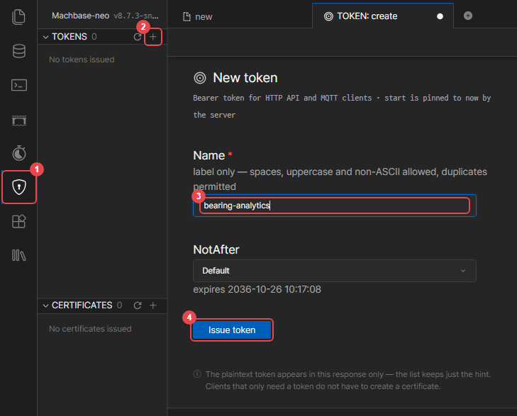
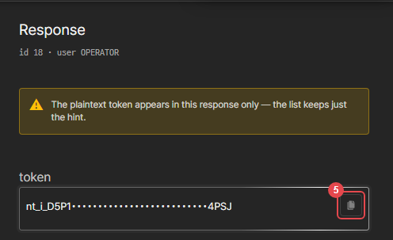
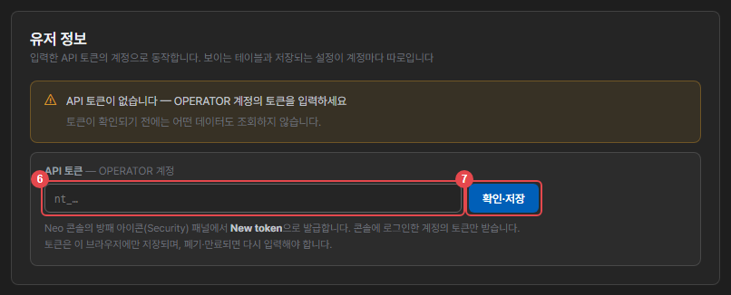
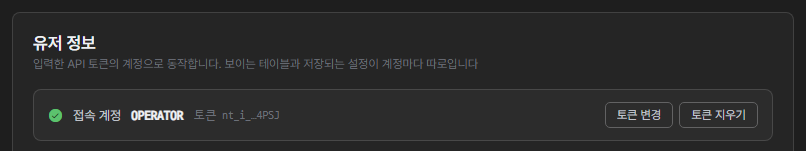

#

> アプリの画面は韓国語です。このガイドでは各画面の表示名を日本語で示し、画面で探しやすいよう必要に応じて韓国語の表示名を括弧内に併記します。

## APIトークンの入力

アプリはNeoコンソールのログインとは別に、**アカウントごとに発行したAPIトークン**でサーバーに接続します。表示されるテーブル、保存される設定、サーバー監視のタイマーは、すべてこのトークンのアカウントの権限で動作します。

### トークンの発行

1. アプリを使うアカウントでNeo Webコンソールにログインします。
2. 盾アイコン（**①**）をクリックし、**TOKENS** の横の **+** ボタン（**②**）をクリックします。
3. トークン名（**③**、例：`bearing-analytics`）を入力し、**Issue token**（**④**）をクリックします。有効期限は **NotAfter** で指定できます（既定は10年）。

   

4. 発行されたトークン（`nt_`で始まる）を、コピーボタン（**⑤**）でコピーします。

   

> トークン文字列は発行時に一度だけ表示されます。紛失した場合は、新しいトークンを発行してください。

### アプリへの入力

1. アプリを開くと、設定画面には **ユーザー情報**（유저 정보）カードだけが表示されます。トークンが確認されるまで、データソースなど他の設定と、モニタリング・詳細分析・レポートの画面は表示されません。コピーしたトークンを入力欄（**⑥**）に貼り付け、**確認・保存**（확인·저장）（**⑦**）を押します。

   

2. 確認されると **接続アカウント**（접속 계정）と伏せ字のトークンが表示され、アプリがそのアカウントで動作します。

   

- **コンソールにログインしているアカウントのトークンだけ**を受け付けます。他のアカウントのトークンは「○○アカウントのトークンです」（○○ 계정의 토큰입니다）と表示され、保存されません。
- トークンは**このブラウザーにだけ**アカウントごとに保存されます。別のブラウザーやPCでは改めて入力します。
- トークンが廃棄・期限切れになると入力画面に戻ります。新しいトークンを入れるとそのまま続行します。サーバー常時監視のタイマーはトークンではなくアカウントに紐づくため、トークンを廃棄しても止まらず、同じアカウントの新しいトークンで引き続き管理できます。
- 変更・削除するには、同じカードの **トークン変更**（토큰 변경）・**トークン削除**（토큰 지우기）を押します。削除するとそのブラウザーでの照会・判定・通知記録が止まります（サーバー常時監視のタイマーは動き続けます）。
- トークンが確認されるまで、データは一切照会しません。

## 始める前に — 保存先と権限

このアプリは**入力したAPIトークンのアカウントで**動作します。表示されるテーブルや保存される設定は、アカウントごとに別々です。
そのため、最初に一度だけ管理者（SYS）による準備が必要です。

| 誰が | 何を |
| :--- | :--- |
| SYS | 設定 → **ユーザー情報** カードで `作成`（만들기） — 専用データベース `NEO_BEARING_STORE` を作成します |
| SYS | 同じカードの **パッケージ利用アカウントの権限**（패키지 사용 계정 권한）一覧で、そのアカウントの行の **権限付与**（권한 주기）を押します（アカウントごとに1回） |
| SYS | 分析するデータテーブルの権限 — `GRANT SELECT ON MACHBASEDB.SYS.<テーブル> TO <アカウント>;` |

権限を付与されていないアカウントには、「データベースにアクセスできません」という案内と `状態確認`（상태 확인）ボタンだけが表示されます。
権限が付与された後にそのボタンを押すと、ページを再読み込みせずにそのまま利用を続けられます。

一覧にはアカウントごとの権限状態（**権限あり**（권한 있음）・**一部のみ**（일부만 있음）・**権限なし**（권한 없음））と、そのアカウントが登録したこのパッケージのタイマー数が表示されます。使わなくなったアカウントは **権限回収**（권한 회수）で元に戻します。設定・イベント・学習値は削除しないため、再び権限を付与すればそのまま引き継がれます。回収する前に、そのアカウントでアラームと帯域抽出をオフにしてください — SYS は他のアカウントのタイマーを代わりに止められないため、残ったタイマーは回収後に毎回失敗します。

アカウント自体を削除するとき（退職など）は、**削除する前に**そのアカウントでログインしてアラームと帯域抽出をオフにし、盾アイコン（Security）の **TOKENS** でそのアカウントのトークンをすべて廃棄してください。Neo はアカウントを削除しても、そのアカウントの API トークンとタイマーを削除しません — 残ったトークンでワークスペースのファイルを読み書きでき、同じ名前でアカウントを作り直すと古いトークンとタイマーが新しいアカウントにそのまま引き継がれます。また、このアプリを使ったアカウントは専用データベースに設定テーブル（`NEO_BEARING_STORE.<アカウント>.CONFIG`）を持つため、SYSがそのテーブルを先に削除しないとアカウントを削除できません — テーブルが残っているアカウントは、Neoが削除を拒否します。

アカウントがNeoコンソールに**ログインすらできない場合**は、デフォルトデータベースへの接続権限がありません（`ERR-2835`）。
これはこのパッケージではなく、Neo自体の前提条件です — `GRANT CONNECT ON DATABASE MACHBASEDB TO <アカウント>;`

## 設定画面

アプリを初めて開くと、モニタリング画面に「保存された設定がありません」（저장된 설정이 없습니다）という案内と **設定開始**（설정 시작）ボタンが表示されます。ボタンをクリックして、**設定**画面で分析対象を指定します。設定は左側の6つのセクションに分かれています。

| セクション | 内容 | 必須 |
| :--- | :--- | :---: |
| データソース | ユーザー情報、表示タイムゾーン、分析するTAGテーブルの選択、別名 | はい |
| 設備情報 | **RPM・ベアリングモデル**（等級に必須）・単位・Class・計測・駆動情報 | **はい** |
| 判定基準 | ゾーン境界（しきい値）、ベースライン学習、帯域・欠陥パターン抽出 | 任意 |
| アラーム設定 | 監視方式、判定周期・RMS区間、通知 | 任意 |
| LLM連携 | 詳細分析・レポート所見用のプロバイダー | 任意 |
| データ管理 | 保存容量の確認、期間・タグ別のデータ削除 | 任意 |

左側のセクション名の横には、手直しが必要な項目の数がバッジで表示されます — 設備情報の **判定不可 N**（판정 불가：RPMやベアリングがないため等級を付けられないタグ）・**未設定 N**（미설정）、判定基準の **未学習 N**（미학습）・**再学習 N**（재학습）。セクションごとにバッジは1つだけ表示され、急ぎのほうが優先されます（判定不可が未設定より、未学習が再学習より優先）。手直しが必要な項目が残っていると、ヘッダーの ⚙ ボタンにもオレンジ色の点が表示されます。

設定を変更すると画面下部に「保存していない変更があります」という案内が表示され、**保存**を押すと実データが再読み込みされます。**変更した値は保存して初めて反映されます** — 保存するまでは、モニタリング画面・アプリ判定・サーバー監視のいずれも以前の設定で動作します。保存せずに他のタブへ移動しようとすると、確認ダイアログが表示されます（**キャンセル**・**破棄して移動**・**保存して移動**）。**破棄して移動**を選ぶと、編集した値は破棄され、保存済みの設定に戻ります。

いくつかのボタンは、押した時点でその値ひとつだけを保存します。

- ヘッダーのアラームのオン/オフ
- 抽出周期変更ダイアログの **適用**
- レポート・詳細分析でのLLMプロバイダーの選択
- 詳細分析の回転数警告にある **実測値 N rpm で保存**

設定タブで保存していないその他の編集は、このとき一緒には保存されません。

## 表示タイムゾーン

**設定 → データソース**の **表示タイムゾーン**で、画面に表示される時刻の基準を選びます。既定値はブラウザーの時刻です。

- カード・チャート・イベント一覧・日付選択・「今日」の基準・レポート・通知文面の時刻は、すべてこのタイムゾーンに従います。
- データの照会はタイムゾーンに関係なく、同じ瞬間を参照します。サーバーとブラウザーのタイムゾーンが異なっていても、照会結果は同じです。
- 工場の現地時刻で表示したい場合は、その地域を選んで保存します。レポートには作成時のタイムゾーンが併記され、レポート内のチャートもそのタイムゾーンで表示されます。

## データソース

まず、どのデータを分析するかを選びます。

1. Neoで検出されたテーブルの一覧が、種類バッジとともに表示されます。
2. 分析するテーブルを選択します。**複数を同時に選択**できます。
3. 選択したテーブルのタグが、下の別名表に表示されます。

初期状態では何も選択されていません。実際に分析するテーブルだけを手動で選択します。

### カラム構成

Machbase TAGテーブルの標準カラム名（`NAME`・`TIME`・`VALUE`）に基づいて照会します。異なるカラム名を使うTAGテーブルにはまだ対応しておらず、一覧ではグレー表示になり、選択できません（理由が併せて表示されます）。

### ROLLUP

推移グラフとサーバー監視は、TAGテーブルの **ROLLUP**（事前に集計しておく要約）を使って高速に照会します。ロールアップがないテーブルも選択できますが、元データを直接集計するため、次の制限があります。

- 詳細分析・レポートの推移グラフは、選んだ期間のうち **直近2時間** だけを表示します。ロールアップ単位の欄に `원본 집계`（元データ集計）が付き、その下に案内が表示されます。
- モニタリング画面が最初に読み込む推移も、直近の約500万行分に縮まります。
- **サーバー常時監視の対象から外れます。** アプリ監視では判定されます。

一覧でロールアップがないテーブルには **ROLLUPなし**（ROLLUP 없음）バッジが付き、そのテーブルを選択すると、何が制限されるかが右側に表示されます。長い期間を見るには、テーブルにロールアップを作成してください。

### 別名

タグは `別名 (タグ名)` の形式で表示されます。元のタグ名が長い場合やコードのような名前の場合は、別名を設定すると分かりやすくなります。別名はモニタリングカード・詳細分析・レポート・通知文面にも使われます。空欄のままにすると、元のタグ名（`NAME`）がそのまま表示されます。タグが多い場合は検索で探します。

### 読み込み上限

クエリの集中を防ぐため、**テーブルあたりタグ60個**、**全体で設備100台**まで読み込みます。上限によって外れたタグには、別名表で **監視除外**（감시 제외）バッジが付き、モニタリング画面の上部にも案内が表示されます。分析対象のテーブルだけを選択して、範囲を絞ることをお勧めします。

### データソースの変動検知

選択したテーブルやタグがDBから削除されたり空になったりすると、モニタリング画面の上部に変動検知バナーが表示されます。**再読み込み**で更新するか、**無視**で閉じることができます。

## 設備情報

各タグがどのような設備なのかを設定しないと、等級は出ません。まだ何も設定していないタグには、オレンジ色の点が表示されます。

> **RPMとベアリングモデルは必須です。** 等級をオンにする欠陥パターンは欠陥周波数グリッドで計算しますが、回転数とベアリングの幾何寸法がないと、そのグリッドを作れません。どちらか一方でも空欄だと、そのタグは**等級が上がりません** — それは「正常」ではなく「判定不可」です。画面では次のように表示されます。
>
> - モニタリングカード：等級の代わりに **判定保留**（판정 보류）バッジ（マウスを重ねると「判定不可」と表示）
> - 設備情報一覧：**判定不可**（판정 불가）フィルターと、左側の **判定不可 N** バッジ
> - 詳細分析：「判定基準 n/N（… 未適用）」
>
> それ以外の項目（単位・Class・計測・駆動）は、空欄のままでも判定は動作します。ただし、空欄の単位は **mm/s（速度）**、空欄のClassは **Class II** とみなします。

| 項目 | 説明 |
| :--- | :--- |
| **RPM** | ベアリングが取り付けられた軸の実際の運転回転数。欠陥周波数グリッドの基準です — **空欄にすると判定されません**（推定はしません） |
| **ベアリングモデル** | カタログから選ぶと、形状値と欠陥周波数が自動計算されます — **空欄にすると判定されません** |
| 単位 | `mm/s`（速度）・`g`（加速度）・`μm`（変位）。センサーが保存する物理量です。空欄だとmm/sとみなすため、**加速度・変位センサーでは必ず正しい単位を選んでください** — 間違えると値を誤って換算し、等級の高さがずれます |
| Class | 設備のClass（I\~IV）。等級の高さを決めるISO 10816のゾーン境界が、この値で決まります。空欄ならClass II |

各項目名の横にある <kbd>?</kbd> にマウスを重ねると、その値が何か、どこで確認できるか、空欄にするとどうなるかが表示されます。一覧の上にある **全体・判定不可** フィルターで、手直しが必要なタグだけを絞り込めます。

**分からない項目は空欄のままにしてください。** その項目で判定する欠陥だけが「この測定では確認できない」として残り、残りの診断はそのまま進みます。推測で埋めると、その推測が判定の根拠になってしまうため、かえって危険です。（単位はデータを投入した時点で既に決まっている値なので、計測担当者に確認してください。）

### RPM — 正確な入力方法

RPMは推定しません。回転数が間違っていると欠陥周波数グリッド全体がずれるのに、画面はいつもどおり等級を出してしまうからです。**銘板で確認して正確に入力するか、空欄のままにして「判定不可」として残してください。**

「正確に入力する」とは、**ベアリングが取り付けられた軸の実際の運転回転数**を入れることです。

- 銘板の**定格回転数**（例：4極60 Hzの電動機なら1750）を入力し、同期速度（1800）は入力しないでください。欠陥パターンはこの値から欠陥周波数を計算し、**許容誤差 1%** で照合するため、同期速度のように2\~3%ずれると欠陥を見逃します。
- 詳細分析がスペクトルから回転数を測定し、入力値と **2% を超えて異なる**場合は、警告とともに **実測値 N rpm で保存** ボタンを表示します。押すとすぐに保存されます。実測値はその時点の負荷に基づくものなので、負荷が大きく変動する設備では、普段の運転点で改めて確認してください。
- 実測値を照合に直接使わない理由 — 公開データで検証したところ、実測値による照合は検出を増やさず、正常時の誤検知だけを増やしました。回転ピークが弱い設備（加速度センサーなど）では、そもそも実測がうまくいきません。
- **ベルト駆動**の場合は、モーターの定格回転数を入力します。センサーがベルトの反対側（ファン・ポンプなど）のベアリングに取り付けられている場合は、設定ボタン → ベルト諸元で **センサー位置を従動側**に設定してください — アプリがプーリ比で従動軸の回転数を換算し、測定した従動軸回転数を入力した場合はその値を使います（下記の計測・駆動情報）。
- **減速機（ギア）出力軸**に取り付けたセンサーの場合は、その軸の回転数（モーター回転数 ÷ 減速比）を入力します。

### ISO Class 基準

| Class | 対象 |
| :---: | :--- |
| I | 小型機械（≤ 15 kW） |
| II | 中型機械（15–75 kW） |
| III | 大型機械・剛性基礎 |
| IV | 大型機械・柔軟基礎 |

### ベアリングと欠陥周波数

ベアリングモデルをカタログから選択すると、形状値（転動体数・転動体径・ピッチ径・接触角）が自動入力され、BPFO / BPFI / BSF / FTF の欠陥周波数がRPMとともに計算されます。表の右側にある **設定** ボタンを押すと、計算された値を確認できます。

- **カタログにないベアリング** — ベアリング欄で **直接入力**（직접 입력）を選ぶと、その行の設定パネルが自動的に開き、**型番欄にカーソル**が置かれます。型番と転動体数 `n`、転動体径 `Bd`、ピッチ径 `Pd`、接触角 `φ` を入力します。直前にカタログの型番を選んでいた場合は、その型番と形状値が欄にあらかじめ入力され、**その値のまま保存**されるため、似た型番から始めて、異なる欄だけを修正できます。
- **型番欄** — 実際の型番（例：`SKF 22218 E`）を記入しておけます（40文字まで）。表のベアリングモデル欄には `SKF 22218 E (직접)`、詳細分析とレポートには `SKF 22218 E (직접 입력)` のように表示され、判定には使われません。
- **ローラーベアリング（22218・23124・NU312 など）** — 一覧にはありません。同じ型番でもメーカーや設計接尾辞（E・CC・CA）ごとにローラー数が異なるため、一つの値で入力すると欠陥周波数がずれて欠陥を見逃します。メーカーのカタログ値を直接入力してください。以前の一覧から選んでいた設備は自動的に直接入力に切り替わり、型番欄に旧型番、形状欄に旧値が移されています（判定結果は変わりません）。パネルにオレンジ色の案内が表示されたら、カタログ値で確認してください。
- **ジャーナル（すべり）ベアリング** — 転動体がないため、BPFO/BPFI/BSF/FTFが定義されません。そのため欠陥パターンを構成できず、**等級が上がらず、カードは常に「判定保留」**（判定不可）と表示され、設備情報の **判定不可** に含まれます。詳細分析のルールベース診断は、1×・2×回転周波数を基準に行われます。

ベアリングを登録すると、詳細分析のFFTに欠陥周波数マーカーが表示され、どのピークがどの欠陥に対応するかを照合できます。

### 複数のタグに一括適用

表の右側にあるコピーボタンを押すと、その行の値を他のタグにコピーするダイアログが開きます。1台の設備のX/Y/Zチャンネルのように、RPM・ベアリング・マウンティングが同じタグをまとめて入力するときに使います。

- **コピーする項目** — 入力済みの値だけがチップとして表示され、クリックでオン/オフを切り替えます。単位・Class・RPM・ベアリング・型番と形状の4欄（直接入力の場合）・計測（マウンティング）・駆動・センサー位置・プーリ径・ベルト長・従動軸回転数・羽根数/歯数。
- **対象** — 同じ設備（名前の前半が同じタグ）・同じテーブル・現在の一覧の中から選びます。

### 計測・駆動情報

表の右側にある **設定** ボタンを押すと、欠陥周波数・形状値とともに、計測・駆動情報を入力する欄が開きます。ボタンに表示される `n/N` は入力の完成度です。

| 項目 | 診断での役割 |
| :--- | :--- |
| マウンティング方式 | センサーの取り付け方式ごとに、信頼できる周波数の上限を決めます — スタッド 10・接着 5・マグネット 2・ハンドプローブ 1 kHz |
| 駆動方式 | 直結・ベルト・ギア。ベルトの場合は、下にベルト諸元の行が表示されます |
| 羽根数・歯数 | 羽根数 × 回転周波数 = ベーン通過周波数（ギアの場合は歯数 × 回転周波数 = かみ合い周波数） |
| ベルト諸元 | プーリの **ピッチ径** D1（駆動・モーター側）・D2（従動側）とベルト長。ピッチ径はベルトが巻き付く位置の直径で、プーリの刻印やカタログに記載された値です（外径より少し小さい）。2つの直径から従動軸の回転数が、長さもあればベルト自体の欠陥（亀裂・欠損）の周波数が計算されます |
| センサー位置（ベルト） | **モーター側**（既定）・**従動側**。センサーがベルトの反対側（ファン・ポンプなど）のベアリングに取り付けられている場合は、従動側を選んでください。従動側の場合、欠陥パターン・欠陥周波数・帯域・回転数警告が **従動軸回転数** で計算され、表のRPM欄に「종동」（従動）タグが付きます |
| 従動軸回転数（従動側の場合） | タコメーターなどで測定した従動軸回転数を入力します。空欄の場合は RPM × D1 ÷ D2 で換算します |

> 従動軸回転数が1\~2%ずれるだけで、欠陥は検出できても部位（外輪・内輪・転動体）を頻繁に取り違えます。プーリの外径で換算すると数%ずれやすいため、ピッチ径を使うか、測定した回転数を入力してください。

いずれも任意入力です。ただし、**マウンティング方式はできるだけ指定することをお勧めします。**

加速度計は取り付け方式によって信頼できる周波数の上限が大きく異なり、特にマグネットマウントは通常2\~5 kHzで自ら鳴ります（共振）。マウンティングを指定すると、その上限を超える帯域は次のように別扱いになります。

- 詳細分析の **帯域別衝撃性（カートグラム）** の探索範囲から除外されます。
- 帯域エネルギーの根拠では、上限を超える帯域の逸脱は **(暫定)**（잠정）と表示されます — 値が上がったのは事実ですが、設備の振動なのか、センサー取り付け部の共振なのかを区別できないという意味です。
- レポートの診断根拠に、除外された帯域も併せて印刷されます。

空欄の場合は上限を設けず、全帯域をそのまま信頼します。

> 等級をオンにする欠陥パターンは、マウンティング設定に関係なく **1\~5 kHz の固定帯域** で計算します。マグネットマウントの共振はこの帯域と重なることがあるため、マグネットマウントの設備で欠陥パターンが検出された場合は、まずセンサーの取り付け状態を確認してください。

### 電源の系統周波数

電気的な欠陥は系統周波数の2倍（60 Hz系統なら120 Hz）に現れ、回転数が変わっても動かない点が、機械的な欠陥との見分け方です。韓国国内は60 Hzの単一系統のため既定値に固定されており、設定欄は通常表示されません。入力されたRPMが他の系統の同期速度（50 Hzなら3000・1500・1000 rpm系列）に一致する場合は、警告とともに選択欄が表示されます。

## 判定基準

等級そのものは、**欠陥パターンがオンにし、ISOゾーンが高さを決めます**（[異常判定の仕組み]()）。この画面では次の項目を設定します。

| 設定 | 役割 | 等級への影響 |
| :--- | :--- | :---: |
| ゾーン境界（しきい値） | 等級の高さ（注意・危険・重大）を分けるISO 10816の境界 | あり |
| ベースライン学習 | 設備ごとの正常状態を学習し、「平常比急増」を根拠として表示 | なし |
| 帯域・欠陥パターン抽出 | 帯域エネルギーの推移を蓄積し、欠陥パターンを測定する周期を決める | 周期のみ |

### マシンクラスとゾーン境界

マシンクラスを選ぶと、そのクラスのゾーン境界（mm/s RMS）がプレビュー表示されます。実際の判定には **各タグのClass**（設備情報）が使われます。

**クラス別しきい値** 表で値を直接修正でき、**既定値に初期化** で元に戻せます。表には2種類の行があります。

| 行 | 既定値 | 使われる場所 |
| :--- | :--- | :--- |
| Class I\~IV（速度 `mm/s`） | **ISO 10816 基準値** | **等級の高さ。** 加速度・変位センサーも速度に換算して、この行で判定します |
| 加速度 `g`・変位 `μm` | 一般的な参考値 | その単位のセンサーにおけるRMS推移の基準線と、期間統計の表示。等級には使われません |

### ベースライン学習

設備が正常なときの状態を学習させると、「平常比」の根拠が一層加わります。

正常運転区間のRMSの中心（μ）と普段の変動（σ）を学習し、限界を超えると **平常比急増** と表示します。絶対値がISOのAゾーンにあっても検出します。ただし、この軸は**等級もイベントも作りません** — カードと根拠表で目視確認するための根拠です。

| 設定 | 値 | 説明 |
| :--- | :--- | :--- |
| 正常学習期間 | 直近1時間 / 6時間 / 24時間 | 長いほど多様な正常状態を含み、基準が頑健になります |
| k（σ倍数） | 数値 | 逸脱判定の感度。`k=3` なら正常データの約99.7%が限界内に収まります。確信がなければ3のままにしてください |

- タグごとに **学習** するか、**全体学習** でまとめて処理します。学習した値は **削除** できます。
- データが学習期間より短い場合は、ある分だけで学習します。
- 学習は、アラーム設定の **RMS区間と同じ単位** で行われます。判定に使う値と同じ方法で学習してこそ、その基準が実際の判定値の分布を表すからです。区間を変更したら、基準も再学習することをお勧めします。
- 未学習のタグがあると、画面上部にその数が表示されます。学習前でも等級判定は正常に動作します。

#### 基準が古くなったとき

学習から1か月を超えたタグがあると、画面上部に通知が表示され、各行に学習時点のバッジが付きます。

アプリは**自動では再学習しません。** 欠陥が進行している最中に学習し直すと、その欠陥が正常基準に取り込まれてしまうためです。整備を行った場合や運転条件が変わった場合は、そのときに手動で **学習** を押して更新してください。

#### タグを削除して作り直した場合

学習値は `テーブル:タグ` の名前をキーとして保存されるため、同じ名前で別の設備を接続すると、古い基準がそのまま適用されます。新しい設備のほうが静かなら異常を検出できず、うるさければ逸脱表示が出続けますが、画面には単に「学習済み」と表示されます。

アプリがこの状況を検知すると、該当する行に **同じ設備 — 維持** / **別の設備 — 初期化** の選択肢が表示されます。複数ある場合は、上部の **確認待ち N件** の行にある **すべて同じ設備 — 維持** でまとめて回答できます（初期化は元に戻せないため、行ごとに個別に押します）。確認するまでの間、そのタグのベースライン・帯域の根拠は停止しますが、等級判定（欠陥パターン・ISOゾーン）はその間も動作し続けます。

#### 学習データがきれいでないとき

学習区間には、通常、正常運転だけが含まれているわけではありません。そのため学習では、次の3点を自動的に処理します。

**瞬間的なスパイクに左右されません。** 中心と変動を、平均・標準偏差ではなく中央値系の手法で推定します。スパイクがいくつか混ざるだけで、標準偏差方式では限界が大きく膨らみ、**逸脱を検出するために作った基準が、かえって逸脱を覆い隠してしまいます。** 中央値方式は、標本の半分が汚染されていても維持されます。

**停止・起動区間は除外します。** 運転レベルの20%を下回った区間（停止・アイドル）と、前後で急変する区間（起動・停止のランプ）を学習から外します。何を除外したかは、学習完了の案内とステータス行に `제외 12개(정지 8·과도 4)`（除外12件：停止8・過渡4）の形式で表示されます。

**停止が大半を占める区間は学習を拒否します。** 学習ウィンドウの大半が停止状態だと「停止状態」が正常として学習され、機械を動かしただけで逸脱と表示されてしまいます。この場合は学習が失敗し、正常運転が大半を占める期間で再学習するよう案内が表示されます。

さらに、ほとんど変動しない信号では、限界がμに近づきすぎないよう、**最低でもμの1.2倍** に保ちます。

> この処理は、欠陥がすでに進行している期間を除外するものではありません。その区間で学習すると、欠陥状態が正常基準になってしまいます。**正常運転であることが確実な期間** を選ぶのは、引き続き利用者の役割です。

### 帯域・欠陥パターン抽出

判定基準画面の一番下にある **帯域エネルギー推移** カードにあります。2つの役割があります。

- **抽出周期**は、**欠陥パターンを測定する周期**でもあります。等級はこの周期ごとに1回変わることがあり、等級確定（2回連続）の1回あたりの長さもこの周期です。帯域抽出をオフにしていても、この周期は適用されます。既定は10分で、10分・30分・1時間から選びます。
- **帯域・欠陥パターン抽出**（대역·결함 패턴 추출）スイッチをオンにすると、全体RMSはほとんど動かないのに特定の周波数帯域だけが跳ね上がる変化 — 代表的なのは初期のベアリング欠陥 — を示す **帯域エネルギー推移** を、サーバーで計算して蓄積します。この値は等級を作らず、根拠としてのみ表示されます。

帯域は回転周波数（1×）を基準に5つの区間（サブシンクロナス・1×帯域・欠陥帯域・高周波・超高周波）に分かれ、超高周波はさらに1\~2・2\~4・4\~8・8 kHz+ の4帯域に細分されるため、合計8つの帯域が蓄積されます。ベアリングの型番があれば、包絡線（エンベロープ）系列（周期性・BPFO・BPFI・BSF）も併せて蓄積されます。

設定は3段階です。

1. **帯域抽出** — スイッチをオンにして、抽出周期を決めます。周期を変更すると、確認ダイアログで以前の区間をどう扱うか（そのまま残す・新しい周期で再計算・帯域ベースラインを初期化）を選んで **適用** します。RPMがないタグは抽出対象から外れます。
2. **過去データの補完** — サンプルが蓄積されるのを待たずに、すでにDBにある生データで過去の区間をさかのぼって計算します。進捗率と予想所要時間が表示され、途中で止めても、補完した分はそのまま使われます。
3. **正常基準の学習** — サンプルが十分にたまったら、帯域ごとに学習します。全体RMSの学習と同じ方式で、同じ自動フィルターが適用されます。

**チャンネル別学習状態** の見出し行にある `학습됨 X/Y`（学習済み X/Y）は、学習を終えたタグ数 / 全タグ数です。各タグの行には `4/9 계열 학습됨`（4/9系列学習済み）のように系列数が表示され、分母はそのタグで測定可能な系列数です — サンプルレートが低い場合やマウンティング上限が低い場合は上位帯域・包絡線系列が外れ、ベアリングの型番がない場合は欠陥周波数系列が外れますが、これは正常です。学習されていない系列は、根拠の表示から外れます。

> 帯域の学習も、**正常運転が確実なとき** に行ってください。欠陥がすでに進行中であれば、その欠陥が正常基準になってしまいます。

## アラーム設定

監視方式（アプリ監視・サーバー常時監視）、判定周期とRMS区間、そして通知（Webhookチャンネル、重大度別の通知方式と再通知）を設定します。アラームの確定は分単位の設定ではなく、**2回連続** のルールで固定されています。

このセクションは扱う内容が多いため、別のドキュメントにまとめています → [アラームとイベント]()

## LLM連携

詳細分析とレポートに文章形式の所見を付け加えるには、プロバイダーを1つ以上設定します。この機能は任意で、接続しなくても他の機能はすべて動作します。

1. プロバイダー（Claude・OpenAI・Gemini・Ollama）を選びます。
2. **APIキー**と**モデル**を入力します。モデルを空欄にすると、プロバイダーごとの既定モデルを使います。
3. Ollamaの場合は、APIキーの代わりに **Ollama URL** を入力します。
4. **接続テスト**で、設定が正しいかを確認します。

複数のプロバイダーを設定しておき、詳細分析・レポート画面のドロップダウンから、その都度選んで使えます。接続テストは検証用にすぎず、機能が有効になる条件は「設定が存在するかどうか」です。

> 所見の論調と判定ルールは、[使い方 › LLM所見]() にまとめています。

## データ管理

このパッケージが作成したテーブルのサイズを確認し、整理する画面です。右上の **更新** で現状を読み込み直します。削除したデータは元に戻せません。

| 項目 | 表示 | できること |
| :--- | :--- | :--- |
| イベント履歴 | 件数・期間・監視対象外の件数 | **期間削除…**（期間内のすべてのタグ）・**タグ別整理…** |
| 帯域エネルギー推移 | 行数・期間・監視対象外の行数 | **期間削除…**（学習区間を含む場合は注意）・**タグ別整理…** |
| 判定状態 | 行数・監視対象外の行数 | **未使用データの整理**（確認なしで即時実行 — 次回の判定時に再作成されるデータ） |
| 学習値 | 脚注のみで表示 | 再学習は同じ場所を上書きするため、増えません。**判定基準へ移動** で管理します |

- **期間削除**は2段階です。まず削除する期間を選び、次の画面で削除される量を確認したうえで、**テーブル名（`EVENTS` または `BAND`）を直接入力** して初めて、削除ボタンが有効になります。イベントを削除すると、その期間を扱ったレポートを再作成できなくなるため、先に [イベントのエクスポート]() で保存しておくことをお勧めします。
- **タグ別整理**は、データは残っているのに現在は監視していないタグ（撤去した設備や、データソースから外した設備）がある場合にのみ表示されます。そのタグの帯域推移・イベント履歴・判定状態をまとめて削除します。期間削除は他のタグまで削除するため、特定の設備だけを削除するときはこちらを使います。

## ページ移動

- [前へ：用語集]()
- [目次に戻る]()
- [次へ：使い方]()
