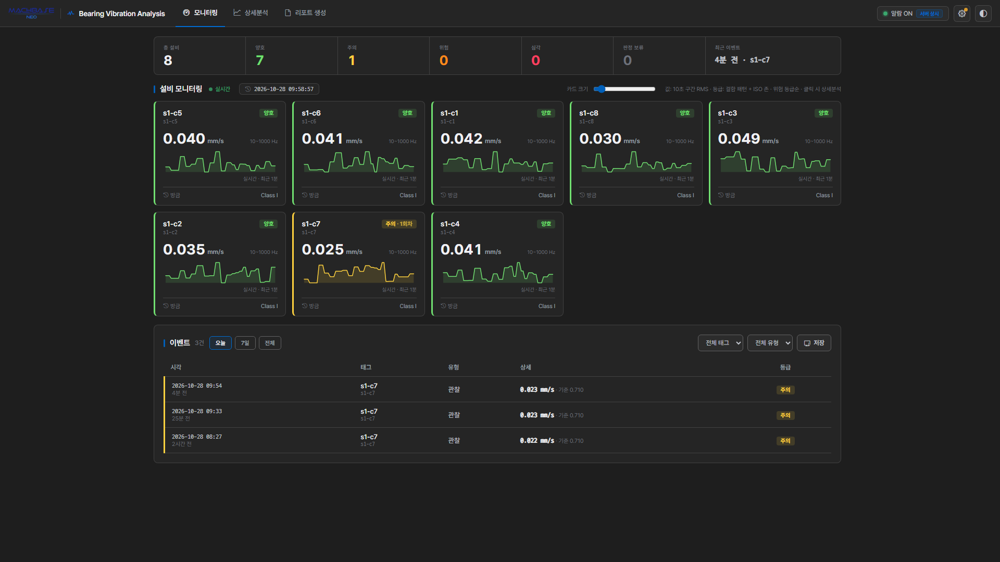
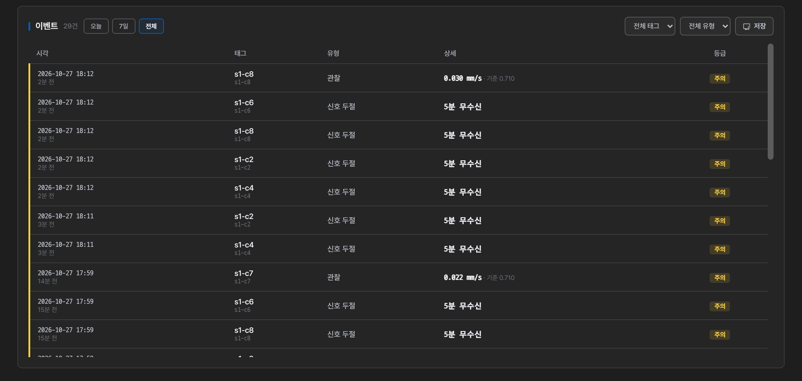
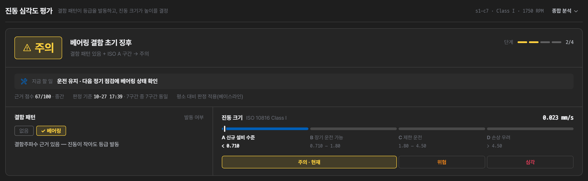
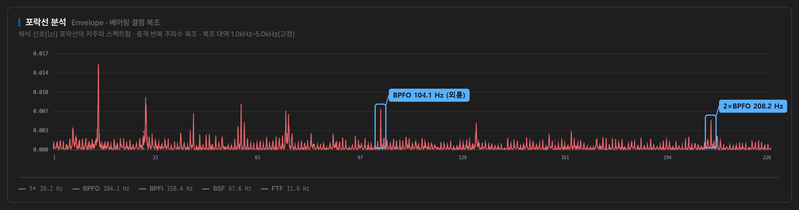
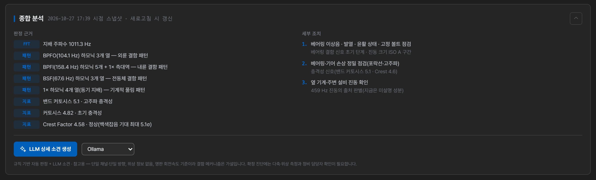
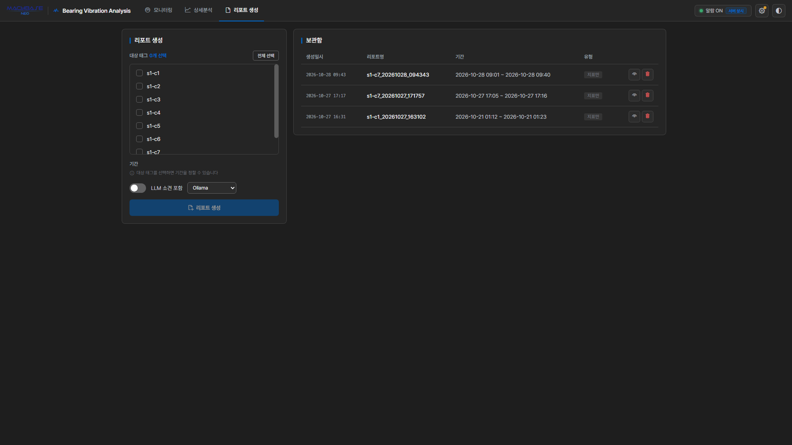
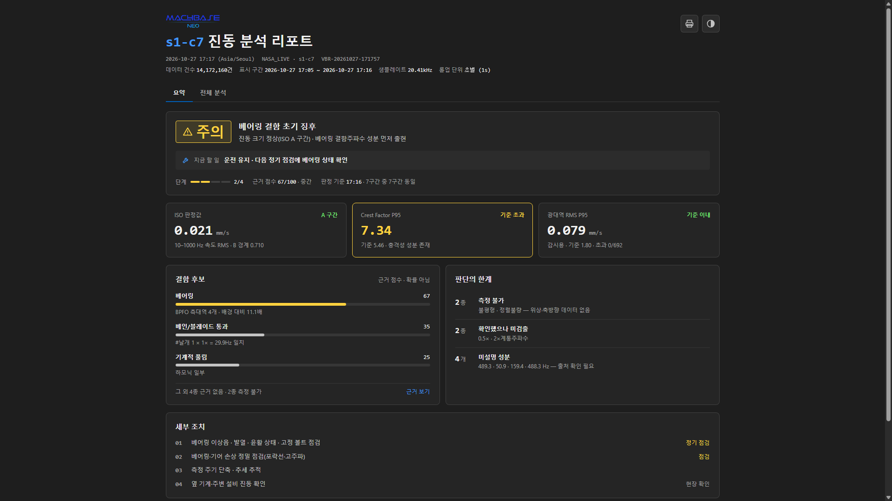

#

설정을 마치면 세 개의 주 탭 — 모니터링 · 상세분석 · 리포트 생성 — 으로 작업합니다.

## 모니터링

전체 설비 상태를 한눈에 보는 화면입니다.

### 요약 바

상단 요약 바에는 다음 칸이 있습니다.

| 칸 | 내용 |
| :--- | :--- |
| 총 설비 | 화면에 보이는 설비 수. 누르면 등급 필터가 풀립니다 |
| 양호 · 주의 · 위험 · 심각 | 등급별 설비 수. 누르면 그 등급만 카드에 걸러 보여 주고, 다시 누르면 풀립니다 |
| **판정 보류** | 지금 등급을 매기지 않는 설비 수. 마우스를 올리면 사유별 내역(계측 이상 · 신호 두절 · 정지 · 판정 못 함 · 결함 패턴 측정 대기·실패 · 판정 대기)이 나오고, 누르면 그 설비만 걸러 봅니다 |
| 최근 이벤트 | 가장 최근 이벤트. 아래 이벤트 목록의 필터와 무관합니다 |

### 설비 카드

선택한 태그마다 카드가 하나씩 생깁니다. 카드를 누르면 그 태그의 **상세분석**으로 이동합니다.

| 카드의 요소 | 뜻 |
| :--- | :--- |
| 별칭 · 태그명 | 데이터 소스가 둘 이상이면 태그명 옆에 테이블 이름이 붙습니다 |
| 등급 배지 | 양호 · 주의 · 위험 · 심각. 꼬리표 `N시간째`는 확정된 뒤 지난 시간, `1회차`·`2회차`는 아직 확정 전인 후보, `복귀 N회차`는 복귀를 확인 중이라는 뜻입니다 |
| 큰 숫자 | 등급 높이를 정하는 ISO 진동값(10\~1000 Hz 대역 RMS, 단위 옆에 `10~1000 Hz` 표시). 가속도·변위 센서는 같은 대역의 원본 단위 값으로 보여 줍니다. 아직 없으면 구간 RMS를 보여 주고 측정 대역을 표시합니다 |
| 숫자에 마우스 | 결함 패턴 검출 여부(격자 점수), 베이스라인·대역 한계 대비 배수, ISO 값과 전대역 값의 차이 |
| 스파크라인 | 최근 1분의 진동 추이 |
| 아래 줄 | 마지막 수신 시각 · Class |

- 기본 정렬은 **위험 등급순**입니다. 카드를 끌어다 놓으면 원하는 순서로 바꿀 수 있고, 그 순서는 저장되어 다음에 열 때도 유지됩니다.
- **카드 크기** 슬라이더로 그리드 밀도를 조절할 수 있습니다.
- 카드의 등급은 알람과 **같은 규칙**으로 매깁니다 — 결함 패턴 추출 주기(기본 10분)마다 결함 패턴이 등급을 켜고 ISO 존이 높이를 정합니다. 알람 설정의 RMS 구간은 운전/정지·신호 두절·계측 이상 판단과 평소 대비 근거에 쓰입니다.

#### 카드 배지

| 배지 | 자리 | 뜻 | 할 일 |
| :--- | :--- | :--- | :--- |
| **판정 보류** | 등급 자리 | 지금 등급을 매기지 않습니다. 마우스를 올리면 사유와 직전 확정 등급이 나옵니다 | 사유에 따라 아래 참고 |
| 정지 | 그래프 위 | 설비가 서 있어 판정을 멈췄습니다(직전 상태 유지) | 조치 불필요 — 운전이 재개되면 판정도 재개됩니다 |
| 신호 두절 | 그래프 위 | 데이터가 들어오지 않습니다. 그래프 선이 흐려집니다 | 수집 경로 확인 |
| 계측 이상 | 그래프 위 | 클리핑·DC 드리프트 등으로 파형을 믿을 수 없습니다 | 센서·케이블·마운팅 확인 |
| 등급 반복 N회 | 오른쪽 위 | 최근 2시간에 등급 악화(임계 초과)가 3회 이상 반복됐습니다 | 누르면 마지막 악화 시점의 상세분석이 열립니다 |

판정 보류의 사유는 위 세 가지(정지 · 신호 두절 · 계측 이상) 외에 다음이 있습니다.

- **판정 못 함** — RPM이나 베어링 형상이 없어 결함 패턴을 세울 수 없습니다(저널 베어링 포함). 설비 정보를 채우십시오.
- **판정 대기** — 앱을 연 직후 첫 판정을 기다리는 중입니다.
- **결함 패턴 첫 측정 대기 / 결함 패턴 측정 실패** — 이번 회차에 결함 패턴을 재지 못해 직전 등급을 유지 중입니다. 다음 회차에 다시 잽니다.

### 테이블 필터

데이터 소스를 둘 이상 고르면 "설비 모니터링" 제목 옆에 **테이블 필터**가 나타납니다. 보고 싶은 테이블만 골라 카드와 요약 바를 좁힐 수 있습니다.

- 화면 표시만 바뀝니다. 감시·알람 대상은 그대로입니다(영구히 빼려면 설정 → 데이터 소스에서 선택을 해제합니다).
- 모두 숨기면 "표시할 테이블을 하나도 고르지 않았습니다" 안내와 **전체 표시** 버튼이 나옵니다.

### 감시 상태 알림

감시가 제대로 돌지 않으면 화면 맨 위에 경고가 표시됩니다. 타이머가 멈췄거나, 돌고는 있는데 판정 대상이 없거나, 앱 판정이 지연된 경우입니다. 대부분 **다시 등록** 버튼으로 바로 조치할 수 있습니다.

"이벤트가 없다"가 설비가 정상이라는 뜻인지 감시가 죽었다는 뜻인지 구분하기 위한 장치입니다. 표시별 뜻과 조치는 [알람과 이벤트 › 감시 상태 확인]()을 참고하세요.

### 이벤트 목록

아래쪽 이벤트 목록에는 기록된 이벤트가 **시각 · 태그 · 유형 · 상세 · 등급**으로 표시됩니다. 각 행을 누르면 그 이벤트가 발생한 시점의 상세분석으로 이동합니다.

**상세** 칸에는 유형에 따라 다음이 적힙니다.

| 유형 | 상세 칸 |
| :--- | :--- |
| 등급 이벤트(관찰 · 임계 초과 · 상태 지속 · 상태 개선 · 정상 복귀), 속도(mm/s) 센서 | 등급 높이를 정한 ISO 값 · 넘어선 존 경계(예: `3.2 mm/s · 기준 2.8`) |
| 등급 이벤트, 가속도(g)·변위(μm) 센서 | 원본 단위 값 · 등급 근거(예: `0.077 g · ISO 위험 구간 · 결함 패턴 외륜(BPFO)`) — 등급은 속도로 환산한 ISO 값으로 매기므로 원본 단위의 기준 숫자가 없습니다 |
| 신호 두절 | 무수신 시간(예: `6분 무수신`) |
| 계측 이상 · 계측 복귀 | 사유(예: `플랫라인`, `계측 정상 복귀`) — 마우스를 올리면 설명이 나옵니다. 진동값이 아니므로 숫자는 적지 않습니다 |

결함 패턴의 격자 점수·부위·회차(예: `격자 3.2 · 외륜(BPFO) · 2회 연속 확정`)는 [내보내기](#이벤트-내보내기) 파일의 '상세' 열과 알림 문구에 적힙니다.

- 기간 칩(오늘 · 7일 · 전체)과 **태그 · 유형** 드롭다운으로 목록을 좁힐 수 있습니다. 필터에 맞는 이벤트 중 최근 **200건**을 표시하고, 건수는 필터에 맞는 전체입니다. 그 이상은 내보내기로 확인합니다.
- 목록은 30초마다 새로 읽습니다 — 서버 감시나 다른 탭이 기록한 이벤트도 새로고침 없이 나타납니다. 지금 감시 중인 태그의 이벤트만 보이며, 선택을 해제한 테이블의 이벤트는 내보내기에서 확인합니다.
- 유형은 여덟 가지입니다 — 설비 등급: **관찰**(1회차 · 알림 안 감) · 임계 초과 · 상태 지속 · 상태 개선 · 정상 복귀, 감시 상태: 계측 이상 · 계측 복귀 · 신호 두절. 각 유형의 뜻은 [이상 판정 원리 › 이벤트]()에 있습니다.

> **베이스라인·대역은 이벤트를 만들지 않습니다.** 이탈해도 목록에는 안 뜨고, 카드와 근거표에 표시만 됩니다. 등급 이벤트는 결함 패턴 추출 주기(기본 10분)마다 나옵니다.

### 이벤트 내보내기

이벤트 목록의 **저장** 버튼을 누르면 기간과 파일 형식(CSV · JSON)을 고르는 창이 뜹니다. 지정한 기간의 이벤트를 파일로 내려받을 수 있습니다. 목록과 달리 선택을 해제한 테이블의 이벤트까지 모두 담깁니다.

CSV 열은 시각 · 테이블 · 태그 · 별칭 · 유형 · 등급 · 지표값 · 기준값 · 상세입니다.

> 알람 판정이 언제 어떻게 이벤트를 만드는지는 [알람과 이벤트]()에서 다룹니다.

## 상세분석

한 태그를 깊이 들여다보는 화면입니다. 모니터링 카드나 이벤트 행에서 들어옵니다.

상세분석은 **스냅샷**입니다 — 들어온 시점의 데이터로 고정되며, 화면이 실시간으로 계속 바뀌지 않습니다. 최신 상태로 다시 캡처하려면 **새로고침**을 누르거나, 태그·기간을 바꿉니다. 들어온 뒤 감시가 본 계측 상태가 달라지면 화면 위에 그 사실과 **새로고침** 버튼이 뜹니다.

### 태그·기간 선택

- 화면 상단의 드롭다운으로 분석할 태그를 바꿀 수 있습니다.
- 조회 기간은 프리셋으로 고릅니다 — 1시간 · 6시간 · 24시간 · 전체, 또는 옆 달력에서 직접 지정. 프리셋은 그 태그의 최신 데이터를 기준으로 잡힙니다.
- 그 태그의 데이터가 프리셋 길이보다 짧으면 해당 프리셋은 비활성화됩니다. 누르면 "데이터가 부족합니다" 안내가 뜨며, 이때는 **전체**로 확인합니다.
- 직접 지정은 날짜 단위입니다(시작일 00:00 \~ 종료일 23:59). 프리셋에서 넘어가면 직전 프리셋 구간의 날짜가 미리 선택됩니다.

차트의 시간축은 선택한 기간 전체를 채웁니다. 데이터가 없는 구간은 빈 곳으로 남아, 실제로 어디에 데이터가 있는지 그대로 보입니다.

### 계측 유효성 경고

신호에서 클리핑(포화)·플랫라인·DC 드리프트·단발 스파이크 같은 계측 이상이 감지되면 화면 위에 **신호 이상 — 센서 점검 필요** 경고가 뜨고, 진단은 **진단 보류** 상태가 됩니다.

포화된 신호는 진폭을 실제보다 낮게 보이게 하고, 시간영역의 단발 임펄스는 스펙트럼 전체를 광대역으로 오염시킵니다. 그래서 이 경고가 떠 있는 동안은 특정 후보만이 아니라 **모든 근거의 신뢰도**가 함께 내려갑니다. 기계를 의심하기 전에 센서·케이블·마운팅을 먼저 확인하세요.

경고 상자 없이 회색 **DC 성분** 안내 한 줄만 있다면 이상이 아닙니다. 평균이 크지만 일정한 센서(MEMS 가속도계의 중력축, 근접 변위센서 등)라는 참고 정보이며 판정은 그대로 진행됩니다. 리포트에도 같은 회색 안내가 들어갑니다.

### 심각도 평가

상단 카드 머리에 종합 등급(아래 막대가 네 단계 중 몇 번째인지 보여 줍니다)과 판정문, 그리고 두 축이 등급을 만든 방식이 한 줄로 나옵니다(예: "결함 패턴 있음 + ISO A 구간 → 주의"). 그 아래에 **지금 할 일** 한 줄과 근거 사실(근거 점수 · **판정 기준 시각**과 기간을 나눈 구간 중 같은 판정이 나온 곳의 수)이 붙고, RPM이나 베어링이 없으면 "판정 기준 n/N (… 미적용)"이 함께 표시됩니다. 결함 패턴을 재지 못했거나 패턴 없이 진동만 큰 경우처럼 이 한 줄로 설명되지 않을 때만 사유 문장이 더해집니다.

머리 아래 두 상자가 등급이 정해진 과정을 보여 줍니다. **① 결함 패턴**은 등급을 켜는 축(없음·있음)이고, **② 진동 크기**는 등급의 높이를 정하는 축입니다 — ISO 존 A~D 막대가 지금 값까지 채워지고, 그 아래 줄에 결함 패턴이 있을 때 구간별 등급(A·B → 주의, C → 위험, D → 심각)이 적힙니다. 존 막대에는 등급색을 쓰지 않고, 존 이름도 등급어가 아닌 규격 뜻(A 신규 설비 수준 · B 장기 운전 가능 · C 제한 운전 · D 손상 우려)으로 적습니다.

**이 등급은 진동 크기(ISO)가 정하는 것이 아닙니다.** 등급을 켜는 것은 **결함 패턴 하나**입니다 — [포락선]()에서 베어링 결함주파수(BPFO·BPFI·BSF·FTF) 자리에 근거가 섰는가. 그 근거가 서야 등급이 오르고, ISO 존은 **오른 등급의 높이**를 정합니다.

그래서 **진동이 커도 결함 패턴이 없으면 등급은 양호로 남고**, 반대로 진동이 평범해도 패턴이 뚜렷하면 오릅니다(진폭에 아직 안 나타나는 초기 베어링 결함이 그 구간입니다). 베이스라인·대역 값은 등급을 움직이지 않고 **근거로만** 함께 표시됩니다.

**기간 통계** 표(ISO 판정값 · Crest Factor P95 · 광대역 RMS P95 · 변화율 · 지속 최악 RMS · 관측 창)는 선택한 기간 전체에서 낸 값입니다. 등급 근거는 ISO 판정값 행뿐이고, 나머지 행은 기준과 비교한 사실(이내 · 초과)만 보여 줍니다. 비고에 마우스를 올리면 산출 조건 전문이 나옵니다.

모니터링 카드와 **같은 판정 규칙**을 쓰므로 두 화면의 등급이 어긋나지 않습니다(상세분석은 더 긴 창으로 기간 안 여러 지점을 잽니다). 자세한 원리는 [이상 판정 원리]()에 있습니다.

### 표시 단위 바꾸기

같은 진동 신호도 **가속도(g) · 속도(mm/s) · 변위(μm)** 중 무엇으로 보느냐에 따라 드러나는 결함이 달라집니다. "스펙트럼 분석" 머리줄의 **표시 물리량** 버튼으로 전환할 수 있으며, 센서가 실제로 측정한 단위에는 `(원본)` 표시가 붙습니다.

| 단위 | 강조되는 것 |
| :--- | :--- |
| 가속도 `g` | 고주파 — 베어링·충격성 결함 |
| 속도 `mm/s` | 중간 대역 — ISO 판정 기준 |
| 변위 `μm` | 저주파 — 불평형·정렬 |

베어링 결함이 의심되는데 속도 파형에서 잘 안 보이면 가속도로 바꿔 보십시오. 전환은 파형·FFT·스펙트로그램·켑스트럼·진단 지표(시간영역) 표시에 적용되고, 리포트를 만들 때도 지금 고른 단위가 쓰입니다. 포락선은 판정 입력이라 늘 센서 원래 단위로 계산하며, 추세와 등급 판정에는 영향이 없습니다.

### 첨도 포화 경고

첨도 추이가 고점에서 내려오는데 RMS는 유지되거나 오르는 경우, 차트 아래에 경고가 표시됩니다.

첨도 하락은 보통 "좋아졌다"로 읽히지만, 이 조합은 결함이 진행돼 **충격이 상시화된 상태**일 수 있습니다. 초기 베어링 결함은 뾰족한 충격으로 첨도를 올리고, 결함이 퍼지면 충격이 이어져 첨도가 다시 내려갑니다. 첨도만 보고 회복으로 판단하지 마십시오.

### 차트

| 차트 | 보는 것 |
| :--- | :--- |
| RMS 추이 | 진동 에너지의 시간 변화 · ISO 존 기준선 |
| Peak-to-Peak · Crest Factor · 첨도 추이 | 순간 충격 크기와 파형의 뾰족함 변화 |
| 결함 대역 에너지 추이 | 주파수 대역별 에너지 변화. 대역 추출을 켜면 포락선 계열(주기성·결함주파수)도 함께 그려집니다. 범례를 누르면 그 계열을 숨기거나 다시 보입니다. **알람 기준으로 보기**를 누르면 각 계열을 학습된 한계로 나눈 비율 축으로 바뀝니다 — 1.0이 학습 한계선이라 어느 계열이 얼마나 가까운지 한눈에 보입니다(대역 베이스라인 학습 필요. 대역은 알림을 내지 않으며 근거로만 씁니다) |
| 원시 파형 | 시간 영역 진동 파형(휠 확대·축소, 드래그 이동, 더블클릭 리셋) |
| FFT 스펙트럼 | 주파수 성분. 베어링 등록 시 1× · 2× · BPFO · BPFI · BSF · FTF 위치를 표시하고 차트 아래에 그 주파수 목록을 둡니다 |
| ↳ 범위 | 기본은 저주파 위주로 보여 주고, **전대역**으로 바꾸면 센서가 측정 가능한 최대 주파수까지 펼칩니다 |
| 스펙트로그램 | 시간-주파수 변화 — 결함 대역이 언제부터 자랐는지 |
| 대역별 충격성(커토그램) | 어느 주파수 대역이 가장 충격성이 큰지 보여 주는 **참고 표시**입니다. 포락선 분석은 이 대역이 아니라 1\~5 kHz 고정 대역에서 합니다. 마운팅 방식을 지정했다면 그 상한 위 대역은 탐색에서 제외됩니다 |
| 포락선 분석 | 충격성 결함이 만드는 변조 성분 — 결함 패턴을 재는 차트 |
| 켑스트럼 | 하모닉·측대역의 주기 성분 |
| 진단 지표(시간영역) | 원시 파형 구간에서 낸 충격·에너지 특성 지표 |

### 진단과 세부 조치

**종합 분석 펼치기**를 누르면 규칙 기반 진단이 표시됩니다. 불평형 · 정렬 불량 · 베어링 내륜/외륜 · 풀림 · 기어 등의 결함을 판정하고, **판정 근거**(어느 지표에서 나온 근거인지 출처와 함께)와 **세부 조치**(지금 할 일을 실행하는 방법 · 판정을 보완할 일, 할 일 아래 이유)를 함께 제시합니다.

세부 조치는 고정 목록이 아니라 판정 결과(결함 패턴 · 진동 크기 · 충격성 · 추세 · 출처를 모르는 진동 · 비어 있는 설비 정보)에 맞는 항목만 골라 최대 5개까지 보여 줍니다. 계측 이상이 걸리면 기계 점검 항목 없이 계측 확인 항목만 나옵니다.

> 이 판정은 단일 채널·단일 방향 측정에 위상 정보 없이, 명판 회전속도를 기준으로 계산됩니다. 결함 메커니즘은 **가설**이며, 확정 진단에는 다축·위상 측정과 정비 담당자 확인이 필요합니다.

### LLM 소견 (선택)

LLM을 연동했다면 종합 분석 아래 **LLM 상세 소견 생성**으로 서술형 전문가 소견을 만들 수 있습니다. 소견은 화면에 표시된 차트의 실측값만 근거로 삼습니다. 프로바이더는 버튼 옆 드롭다운에서 고르고, 생성에 쓰인 모델명이 소견 아래에 남습니다.

소견은 진동 분석 전문가가 아닌 설비 담당자가 읽는다고 보고 **지금 상태 · 그렇게 보는 이유 · 권장 행동** 세 질문에 답합니다. LLM은 전문용어로 된 측정 데이터를 그대로 읽지만, 소견에는 쉬운 말로 풀어 씁니다(예: "BSF 측대역" → "베어링 볼 쪽 신호").

판정(등급 · 원인 순위 · 조치)은 엔진이 이미 정했고, LLM은 그 뜻을 풀어 줄 뿐입니다. 값을 새로 계산하거나 순위를 뒤집지 않고, 계측 이상 경고가 걸리면 결론을 잠정으로 맺고, 원리상 판별할 수 없는 항목을 "가능성 낮음"으로 쓰지 않고, 등급을 부풀리지 않습니다. 권장 행동은 화면의 지금 할 일과 세부 조치만 다루며 새 조치를 만들지 않습니다.

LLM을 연동하지 않았으면 규칙 기반 진단만으로도 충분히 동작합니다.

## 리포트 생성

분석 결과를 문서로 남기는 화면입니다.

1. 리포트에 담을 **대상 태그**를 고릅니다. (기본은 미선택, 전체 선택 지원)
2. **기간**을 고릅니다 — 프리셋(1시간 · 6시간 · 24시간 · 전체)은 **태그마다 그 태그의 최신 데이터를 기준으로** 잡히고, 달력으로 직접 지정한 구간은 선택한 태그 전부에 그대로 적용됩니다. 직접 지정한 기간에 데이터가 없는 태그가 있으면 경고와 함께 그 태그의 데이터 구간이 안내됩니다.
3. 필요하면 **LLM 소견 포함**을 켜고 프로바이더를 고릅니다.
4. **리포트 생성**을 누릅니다.

**선택한 태그마다 리포트 파일이 하나씩** 만들어집니다. 파일 이름은 `태그명_생성일시.html` 형태입니다.

생성은 데이터 조회 → 지표 계산 → 소견 생성 → 저장의 네 단계로 진행되며, 진행 상황이 표시됩니다. 오래 걸리면 **생성 중단**으로 취소할 수 있습니다. 완성된 리포트는 로그인한 계정의 폴더(`<계정>/vibration-reports/`, 계정 이름은 소문자)에 저장됩니다.

### 리포트 구성

리포트 상단의 **요약** · **전체 분석** 탭으로 보기를 전환합니다. 요약은 한눈에 판독하는 용도이고, 전체 분석은 모든 차트와 근거를 번호 붙은 절(01 심각도 ~ 05 세부 조치) 순서로 펼칩니다. 요약의 **근거 보기** · **심층 분석 보기** 링크는 전체 분석의 해당 절로 이동합니다.

| 탭 | 내용 |
| :--- | :--- |
| 요약 | 등급(네 단계 중 위치)과 판정 · 지금 할 일 · LLM 소견 핵심 요약(연동 시) · 핵심 수치(ISO 판정값 · Crest Factor P95 · 광대역 RMS P95) · 결함 후보 · 판단의 한계 · 세부 조치 |
| 전체 분석 | 심각도(결함 패턴 × 진동 크기, 지표 표) · 추세 · 스펙트럼(FFT · 원시 파형 · 스펙트로그램 · 포락선 · Kurtogram) · 결함 근거(근거 점수 0\~100 · 반대 증거 · 미설명 성분) · 세부 조치 · LLM 소견(연동 시) · 측정 정보 |

리포트의 판정·근거·조치 문구는 개조식(명사형, "~함/~임")으로 적힙니다. LLM 소견은 핵심 요약 한 줄과 지금 상태 · 그렇게 보는 이유 · 권장 행동 세 부분으로 정리되며, 1순위 근거 점수가 70점 미만이거나 계측 이상이면 **잠정 판정**으로 표시됩니다.

스펙트럼 절의 FFT는 결함 주파수가 보이는 기본 범위로 그리고, **전대역** 버튼으로 센서가 잴 수 있는 최대 주파수까지 펼칩니다. 차트 아래 기준 주파수 목록(회전 배수 · 베어링 결함 주파수)에서 근거가 가리킨 성분은 테두리로 표시됩니다.

인쇄하면 전체 분석이 라이트 테마로 출력됩니다. 차트는 한 열로, FFT는 화면에서 고른 범위로, 측정 정보는 한 줄로 나갑니다.

> **인쇄는 리포트 상단의 인쇄 버튼**(인쇄 · PDF로 저장)으로 하십시오. 앱에서 연 리포트는 콘솔과 격리된 틀 안에 떠 있어서(리포트 파일이 로그인 정보·API 토큰에 닿지 못하게), 브라우저의 Ctrl+P는 바깥 틀만 인쇄합니다.

저장된 리포트는 외부 참조가 없는 **자립형 HTML 파일**이면서, 차트가 그림이 아니라 살아 있습니다 — 휠 줌 · 드래그 · 툴팁이 동작하고, 테마 전환에 맞춰 다시 그려집니다. 파일 하나만 전달해도 상대가 같은 방식으로 들여다볼 수 있습니다.

각 리포트에는 **판정 지문**이 남습니다. 판정 엔진의 규칙에서 계산되므로, 지문과 임계값(Thresholds) 칸이 같은데 숫자가 다르면 데이터가 달라진 것이고, 지문이 다르면 패키지(판정 엔진)가 바뀐 것입니다.

### 보관함

오른쪽 보관함에는 저장된 리포트가 다음 열로 표시됩니다.

| 열 | 내용 |
| :--- | :--- |
| 생성일시 | 리포트를 만든 시각 |
| 리포트명 | 파일 이름(`태그명_생성일시`). 마우스를 올리면 대상 태그가 나옵니다 |
| 기간 | 리포트가 다룬 기간 |
| 유형 | **LLM 소견**(소견 포함) 또는 **지표만** |

각 행의 눈 모양 버튼으로 미리보기, 휴지통 버튼으로 삭제합니다(확인 창이 뜨며 되돌릴 수 없습니다). 건수가 많으면 페이지를 넘겨 봅니다.

## 사용 팁

- 처음에는 태그 한두 개만 선택해 동작을 확인한 뒤 대상을 넓힙니다.
- 등급이 나오려면 **설비 정보**에 RPM과 베어링 모델이 있어야 합니다. 가속도·변위 센서라면 단위도 꼭 맞게 고르십시오 — 비워 두면 속도(mm/s)로 간주해 등급 높이가 틀어집니다.
- "평소와 다른" 변화까지 근거로 보려면 정상일 때 **베이스라인 학습**을 해 둡니다.
- 앱을 닫아도 감시가 이어져야 하면 **서버 상시 감시**로 바꿉니다.
- 이벤트가 쌓이면 주기적으로 **저장**으로 내보내 별도 보관합니다.
- 극단적인 지표를 봤을 때는 계측 유효성 경고를 먼저 확인합니다 — 오진의 상당수는 기계가 아니라 센서 쪽입니다.

## 문서 이동

- [이전: 첫 설정]()
- [목차로 돌아가기]()
- [다음: 알람과 이벤트]()
